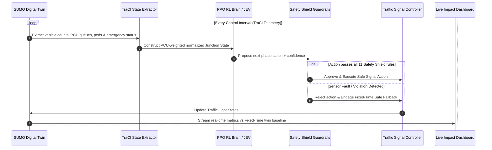

# AI-Based Traffic Management and Adaptive Signal Control
**Trustworthy, Explainable, Safety-Shielded Adaptive Signal Control for Indian Mixed Traffic**

---

## 🚦 System Architecture & End-to-End Execution Flow

Our AI-based adaptive traffic management system begins by collecting real-time traffic data from the SUMO simulation, including vehicle types, PCU-weighted queue lengths, waiting times, current signal phases, pedestrian waiting times, and emergency vehicle status. This information is converted into a junction state and provided to the reinforcement learning (PPO/DQN) agent, which selects the next signal action to reduce traffic delay and queue length. 

Before execution, the **Safety Shield** validates the proposed action against predefined safety rules, including legal signal transitions, minimum green time, conflicting movements, and sensor or system faults. If the action is safe, it is applied to the actual traffic-light controller; otherwise, it is rejected, and the system follows the appropriate safe fallback procedure. 

The simulation then advances, vehicles move, traffic conditions change, and the controller repeats this process continuously. In parallel, the same traffic demand is evaluated using a fixed-time controller, allowing our system to compare average delay, queue length, and throughput through a live monitoring dashboard. If an emergency vehicle is detected, the emergency module requests signal priority through the Safety Shield to coordinate a green corridor across successive junctions. Finally, the dashboard displays the traffic conditions, AI decisions and explanations, safety status, and measured performance against the fixed-time baseline, providing evidence of the system's effectiveness through simulation results rather than unsupported performance claims.

### System Pipeline Diagram



---

## 🌟 4 Headline Features

1. **MIXED-TRAFFIC RL BRAIN**
   - Indian Passenger Car Unit (PCU) weighted state representations:
     - Car = 1.0, Motorcycle = 0.5, Bus = 3.0, Truck = 3.0, Auto = 0.75
   - Custom Gymnasium Environment (`TrafficSignalEnv`) with normalized observation space.
   - PPO (Proximal Policy Optimization) RL agent trained via Stable-Baselines3.

2. **SAFETY SHIELD & EXPLAIN ENGINE**
   - **Safety Shield**: Deterministic guardrail enforcing 11 hardware, timing, pedestrian, and clearance rules (minimum green 10s, maximum green 60s, yellow clearance 4s, emergency override).
   - **Explain Engine**: Human-readable natural language justifications for every signal phase decision.
   - **Break-It Fault Injection**: Simulated sensor/communication failure trigger that safely blocks PPO control and shifts system to Fixed-Time Fallback mode without crashing.

3. **LIVE COUNTERFACTUAL TWIN & IMPACT DASHBOARD**
   - Parallel evaluation comparing Adaptive AI control vs Fixed-Time baseline on identical traffic demand and seeds.
   - Empirical impact metrics: Delay Reduction %, Queue Reduction %, Throughput Improvement %, Pedestrian Wait Saved %, Emergency Travel Time Saved %.

4. **EMERGENCY GREEN CORRIDOR & GREEN WAVE**
   - Safe emergency pre-emption with siren/priority verification.
   - Coordinated signal timing across multi-junction corridor ($J_1 \rightarrow J_2 \rightarrow J_3$) avoiding downstream congestion spills.

---

## 📁 Modular Folder Structure

```
c:\Users\avine\Documents\erode hackathon\
├── config/                  # Central configuration & timing parameters
│   ├── default_config.py
│   └── __init__.py
├── simulation/              # SUMO Digital Twin & TraCI interface
│   ├── sumo/                # Network XML files, routes, vehicle types
│   ├── traci_controller.py
│   └── state_extractor.py
├── rl/                      # Reinforcement Learning Brain
│   ├── pcu.py               # Indian PCU calculator
│   ├── reward.py            # Multi-objective reward function
│   ├── environment.py       # Custom Gymnasium Environment
│   └── train_ppo.py         # PPO trainer
├── decision/                # Governance & Explainability
│   ├── jev.py               # JEV Decision Evaluation Layer
│   ├── safety_shield.py     # Deterministic Safety Shield
│   ├── fallback_controller.py # Fixed-Time Fallback
│   └── explain_engine.py    # Explain Engine
├── counterfactual/          # Twin Comparison & Metrics
│   ├── metrics.py
│   └── comparison.py
├── emergency/               # Emergency Corridor & Green Wave
│   ├── emergency_detector.py
│   └── green_wave.py
├── backend/                 # FastAPI & WebSocket server
│   └── app/
│       ├── main.py
│       ├── api/routes.py
│       ├── websocket/handler.py
│       ├── services/simulation_service.py
│       └── database/db.py   # SQLite decision audit log
├── frontend/                # React + Vite + TypeScript Dashboard
│   └── src/
└── tests/                   # Automated test suite
    └── test_system.py
```

---

## 🚀 How to Run

### 1. Run System Test Suite
```bash
python tests/test_system.py
```

### 2. Generate SUMO Network & Routes
```bash
python simulation/net_generator.py
python scripts/generate_demand.py normal
```

### 3. Train PPO Reinforcement Learning Agent
```bash
python rl/train_ppo.py 2000
```

### 4. Start FastAPI Backend & WebSocket Server
```bash
python -m uvicorn backend.app.main:app --reload --port 8000
```

### 5. Start React Frontend Dashboard
```bash
cd frontend
npm run dev
```
Open [http://localhost:5173](http://localhost:5173) in your browser.

---

## 📽️ Hackathon Demo Sequence (16-Step Flow)
1. **Open Dashboard**: View 4-way Digital Twin visualization.
2. **PCU State**: Observe PCU-weighted queues for cars, 2-wheelers, buses, trucks, and autos.
3. **PPO Proposals**: Watch PPO propose signal phase actions.
4. **JEV Evaluation**: Inspect JEV confidence scores and analytical notes.
5. **Safety Shield Check**: Observe rule approval status.
6. **Explain Engine**: Read real-time decision explanations ("Why did AI choose this phase?").
7. **Press [ BREAK-IT ]**: Inject simulated sensor failure.
8. **Verify Fallback**: Watch PPO block instantly, Safety Shield flag fault, and Fixed-Time Fallback activate.
9. **Reset Fault**: Return to AI Control.
10. **Emergency Corridor**: Click 'Trigger Ambulance'.
11. **Green Wave**: Observe priority clearance across $J_1 \rightarrow J_2 \rightarrow J_3$.
12. **Impact Dashboard**: Review empirical delay, queue, throughput, and emergency time saved metrics.

---

## ⚠️ Important Limitations & Disclaimer
- **Simulation-Based**: Evaluated inside SUMO simulation using calibrated Delhi traffic density profiles.
- **Scope**: Single primary 4-way junction with 3-junction coordinated corridor abstraction.
- **Field Validation**: Real-world deployment requires integration with physical traffic controllers and hardware sensor calibration.
